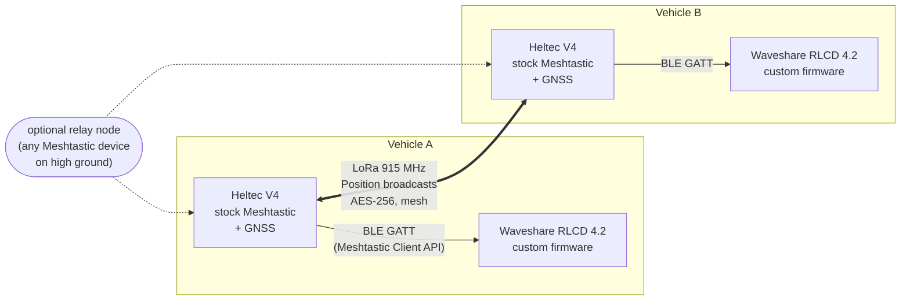
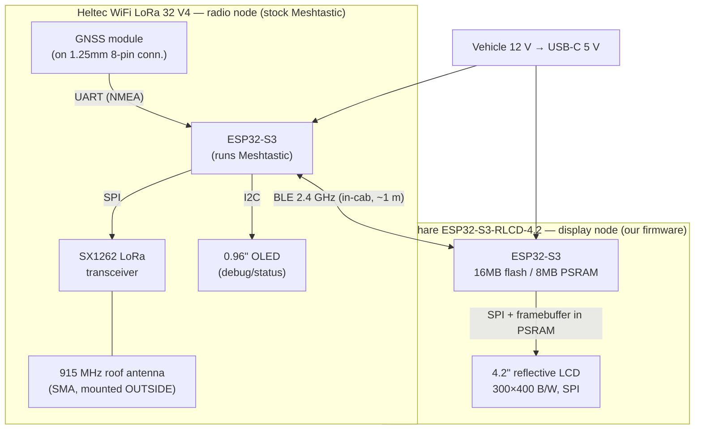
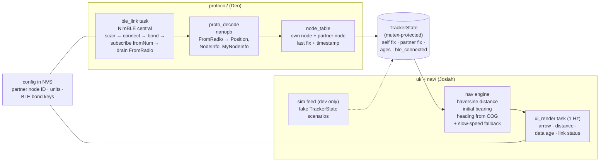
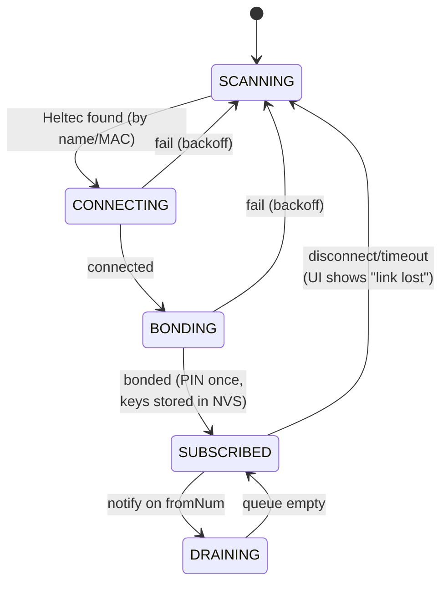

# System Architecture — Off-Grid Vehicle Tracker

Detailed architecture: hardware blocks and buses, firmware structure, data flow, and the
rationale for every major decision. Companion to [DESIGN.md](../DESIGN.md) (plan/risks) and
[TELECOM_ANALYSIS.md](TELECOM_ANALYSIS.md) (link budget). All equipment is in hand.

---

## 1. System context

Two identical vehicle installations. Positions flow symmetrically; nothing is a "server."



## 2. Hardware architecture (one vehicle)



Notes that matter:
- The **only antenna that leaves the cab** is the LoRa antenna. BLE and GPS work fine inside
  (GPS antenna on the dash with sky view; test reception through the windshield first).
- Both boards are ESP32-S3, so the team shares one toolchain (ESP-IDF / Arduino core).
- The Heltec's OLED stays useful for free: Meshtastic shows node count, GPS lock, and
  RSSI of last packet on it — Victor's field-debug display, zero work.

## 3. Firmware architecture — display node (the only custom firmware)

FreeRTOS tasks connected by one shared state struct. Deo owns the left half, Josiah the
right half; `TrackerState` is the contract in the middle.



Key structural choices:
- **One writer, one reader.** Only the protocol side writes `TrackerState`; only the UI side
  reads it. One mutex, no ordering bugs, and the halves never call into each other.
- **The sim feed is a first-class component**, not a hack: Josiah's entire UI, including the
  arrow math, is testable on a bench with no radio at all (scenarios: partner approaching,
  stationary, stale data, BLE dropped).
- **Pairing is configuration, not code**: the partner's Meshtastic node ID is stored in NVS
  and selectable from the UI, so the same firmware runs in both vehicles.

## 4. End-to-end data flow

```mermaid
sequenceDiagram
    participant GB as GPS (Vehicle B)
    participant MB as Meshtastic B
    participant MA as Meshtastic A
    participant P as protocol/ (Deo)
    participant U as ui/+nav/ (Josiah)
    GB->>MB: NMEA fix (UART, 1 Hz)
    Note over MB: every 30–60 s
    MB-)MA: LoRa broadcast: Position{lat,lon,course} (AES, ~0.5 s airtime)
    MA-)P: BLE notify fromNum → read FromRadio (protobuf)
    P->>P: nanopb decode → node_table update
    P->>U: TrackerState{self, partner, ages, link}
    U->>U: bearing − own course → arrow angle; haversine → distance
    U->>U: redraw RLCD (1 Hz)
    Note over MA,P: own position takes the same path,<br/>minus the LoRa hop
```

## 5. BLE link state machine (the risky component, made explicit)



The UI always renders — with the last known data plus an honest age and link flag — no
matter what state the BLE link is in. Link loss degrades the display; it never blanks it.

## 6. Why this architecture works

**6.1 — The custom-code surface is minimized and de-risked.**
Everything hard about long-range radio — GPS parsing, broadcast scheduling, AES encryption,
mesh relaying, radio timing tuned per region, retry/backoff — ships tested inside stock
Meshtastic, maintained by a large open-source project. Our custom firmware is a *client
application* on a documented, versioned API (the same protobuf stream Meshtastic's own
phone apps use, so it cannot silently rot). We hack nothing, fork nothing.

**6.2 — Every interface can be tested in isolation, before integration.**

| Interface | Independent test (no other custom code needed) |
|---|---|
| GPS → Meshtastic | Heltec OLED + Meshtastic phone app show the fix |
| LoRa A ↔ B | Two phones running the Meshtastic app see each other's position |
| BLE Client API | Meshtastic Python CLI over BLE from a laptop proves the API before Deo's code touches it |
| TrackerState → UI | Sim feed drives the full UI with zero radios |
| Whole chain | Bench: walk one Heltec around the parking lot, watch the arrow |

This is why the schedule can run four people in parallel: no one's test depends on
someone else's unfinished code.

**6.3 — The vehicle constraints drove the component choices.**

| Decision | Why, given the vehicle environment |
|---|---|
| Reflective LCD (not TFT/e-paper) | Sunlight-readable on a dash where a TFT washes out; refreshes fast enough for a rotating arrow, which e-paper isn't; near-zero power |
| Heading from GPS course-over-ground (no compass) | A magnetometer inside a steel vehicle is unreliable; COG is accurate above ~5 mph, and a driving use case is, by definition, usually moving |
| Separate display unit (not a phone, not the Heltec's OLED) | Off-grid means no phone dependency; drivers need a glanceable 4.2″ screen, not a 0.96″ OLED; phones die in cold vehicles |
| 12 V vehicle power (no battery management) | Both units powered whenever the vehicle runs — the exact time tracking is needed |
| Connectionless position broadcasts, no ACKs | A newer position supersedes an older one; the meaningful reliability metric is **staleness**, which the UI displays — so a dropped packet costs 30 s of freshness, never correctness |

**6.4 — The wireless-link requirement is satisfied the cheap way.**
Dr. Gale's spec calls for a wireless connection between the radio module and the display,
and names BLE and ESP-NOW as candidates. ESP-NOW would require custom firmware on *both*
boards (stock Meshtastic doesn't speak it) — it only makes sense in a full-custom fallback.
BLE costs nothing: Meshtastic already serves its entire API over BLE. And if BLE bonding
proves hostile (decision point: week 5), Meshtastic serves the *identical protobuf stream*
over WiFi/TCP port 4403 — the transport swaps out under `ble_link` without touching the
decoder, the state, or any of Josiah's code.

**6.5 — It degrades gracefully at every failure point.**

| Failure | Behavior |
|---|---|
| Partner out of LoRa range | Arrow holds last fix; age counts up; driver sees "4 min old" |
| Own GPS loses lock | Distance/bearing still computed from last own fix; flagged |
| BLE drops in-cab | UI shows link-lost; `ble_link` re-scans and re-bonds automatically |
| Vehicle stationary (no COG heading) | Arrow falls back to compass-rose mode (north-referenced) |
| Terrain blocks direct path | Any Meshtastic node in the mesh relays automatically (hop limit 3) |

**6.6 — And it scales without redesign.** A third vehicle is just a third Heltec on the
same channel; the node table already tracks multiple nodes, so "select partner" becomes
"cycle partners." A base-camp node, a hiker with a handheld Meshtastic device — all join
the same mesh for free. None of this is scheduled work, but the architecture gets it for
free, which is worth a slide in the final presentation.

## 7. First bench session (equipment is here — do this next)

1. **Victor:** flash both Heltecs at flasher.meshtastic.org, plug GNSS modules, set region
   US/915, same channel on both → both positions visible in the phone app. *(Proves rows
   1–2 of the interface-test table.)*
2. **Deo:** `pip install meshtastic`, then from a laptop: `meshtastic --ble-scan` and
   `meshtastic --ble <name> --nodes` → proves the BLE Client API end-to-end before writing
   a line of firmware. *(Proves row 3.)*
3. **Josiah:** build & flash the Waveshare vendor demo → screen alive; start the sim feed.
4. **Cannon:** photograph setups, log board revisions/firmware versions in `testing/`,
   start `parts.md` ledger with what arrived.
